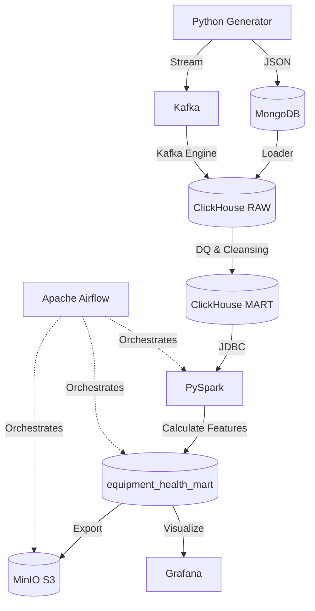
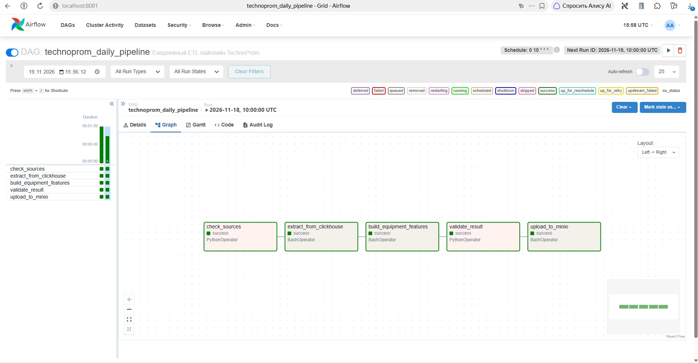
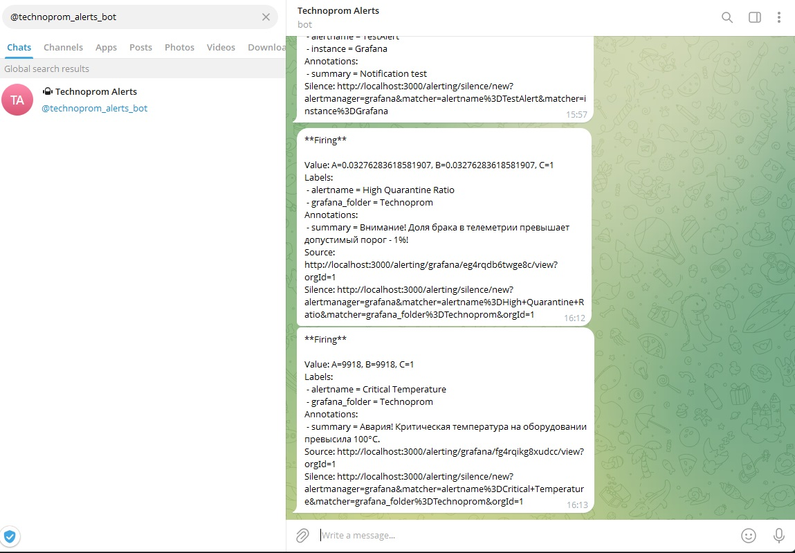
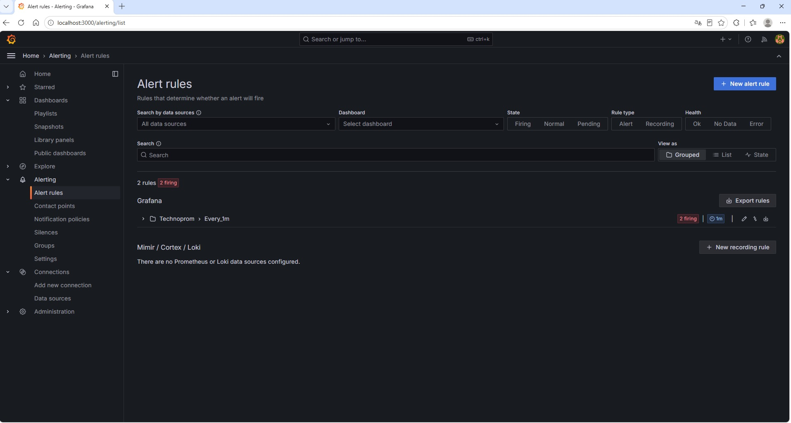
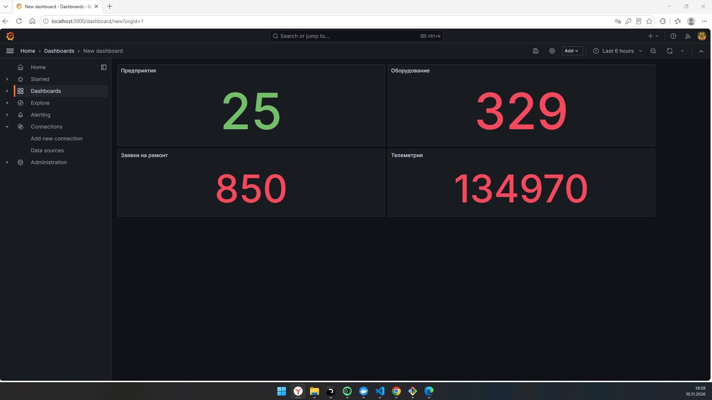
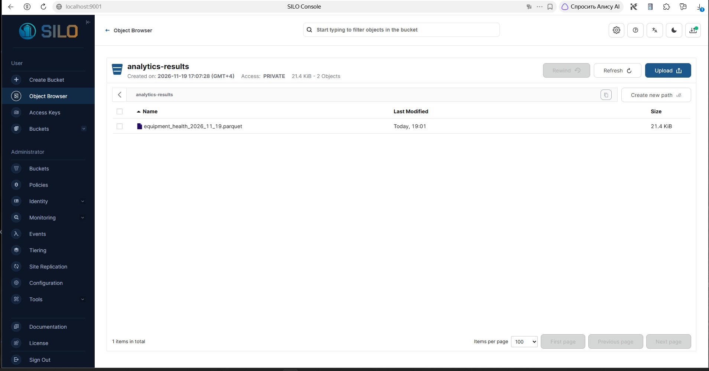

# Промышленная аналитическая платформа «ТехноПром»

Прототип промышленного Data Engineering пайплайна: от генерации сырых данных до аналитической витрины. Проект эмулирует реальный контур заказчика, разворачивая локальную инфраструктуру для потоковой обработки данных, проверки качества и визуализации.

## 👥 Команда

- **Олег Поляков** — Data Engineer (Full pipeline: infra, ingestion, DQ, MART, orchestration)

## 🏗 Архитектура

1. **Генерация данных (Python):** Эмуляция OLTP-системы и IoT-шлюзов.
   * Справочники, заявки и аварии пишутся в **MongoDB**.
   * Телеметрия стримится в **Apache Kafka**.
2. **Слой RAW (ClickHouse):** Поток из Kafka через `Kafka Engine` и `Materialized View` приземляется в сырые таблицы `MergeTree` в том виде, в котором пришел от заказчика.
3. **Слой MART & DQ (ClickHouse):** Очистка, нормализация, отсев «грязных» данных в карантин (`quarantine_events`) и расчет витрин (`mart_telemetry`).
4. **Feature Engineering (PySpark):** Расчет 30 агрегатов технического состояния оборудования и формирование витрины `equipment_health_mart`.
5. **Сервинг и BI:** Итоговая витрина отгружается в **MinIO (S3)**, а дашборды строятся в **Grafana**.
6. **Оркестрация:** Управление пайплайном через **Apache Airflow**.



## 💻 Минимальные требования к оборудованию

Проект разворачивает тяжеловесный стек (Spark, Airflow, ClickHouse, Kafka, MongoDB, Grafana, MinIO), поэтому требования к ресурсам довольно высокие:

*   **RAM:** Минимум **8 ГБ** (при 8 ГБ WSL2 может сильно тормозить). Рекомендуется **16 ГБ**.
*   **CPU:** Минимум **4 ядра**.
*   **Диск:** Минимум **10 ГБ** свободного места (Docker-образы и данные Kafka/ClickHouse занимают много места).
*   **ОС:** Windows 10/11 (с WSL2), macOS, Linux.

## 🛠 Стек технологий

* **Источники:** MongoDB, Apache Kafka
* **Хранилище и обработка:** ClickHouse, PySpark
* **Оркестрация:** Apache Airflow
* **Визуализация:** Grafana
* **Объектное хранилище:** MinIO (S3-совместимое)
* **Инфраструктура:** Docker Compose

## 🚀 Быстрый старт

### 1. Запуск инфраструктуры
Убедитесь, что у вас установлен Docker Desktop. В корне проекта выполните:
```bash
docker compose up -d --build
```
*(Флаг `--build` соберет кастомный образ Airflow с нужными библиотеками).*
Дождитесь, пока все контейнеры перейдут в статус `Up`.

### 2. Инициализация Airflow
Выполните однократно для создания таблиц в базе данных и создания пользователя:
```bash
docker compose run --rm airflow-webserver airflow db init
docker compose run --rm airflow-webserver airflow users create --username airflow --firstname Airflow --lastname Admin --role Admin --email admin@example.com --password airflow
```

### 3. Установка Python-зависимостей и генерация данных
```bash
pip install -r requirements.txt
python generate.py
python scripts/load_mongo_to_clickhouse.py
```

### 4. Запуск пайплайна через Airflow
Откройте UI: http://localhost:8081 (логин `airflow` / `airflow`).
Включите DAG `technoprom_daily_pipeline` и нажмите **Trigger DAG**.

## 🧮 Формула Health Score

Итоговый балл (`health_score`) рассчитывается как `100 - сумма штрафов`, с ограничением результата в диапазоне от 0 до 100:

* **-20** за аномальную температуру (`temperature_anomaly`)
* **-15** за частые поломки (`frequent_breakdown` — >=3 ремонтов за 30 дней)
* **-15** за повторяющиеся неисправности (`repeated_failure` — один тип аварии >=2 раз за 30 дней)
* **-15** за аномальную вибрацию (`vibration_anomaly`)
* **-10** за просроченное ТО (`maintenance_overdue`)
* **-10** за разрывы в телеметрии (`telemetry_gap_detected` > 4 часов)
* **-10** за нестабильную работу (`unstable_equipment` — комбинация признаков)

## 📸 Демонстрация работы

### Оркестрация в Apache Airflow
Граф задач DAG `technoprom_daily_pipeline`: от проверки источников до выгрузки в S3.


### Алерты в Telegram
Уведомления от Grafana о превышении доли брака и критических температурах.


### Правила алертинга в Grafana
Настроенные правила для мониторинга качества данных и состояния оборудования.


### Дашборд в Grafana
Визуализация контрольных показателей (25 предприятий, 300+ единиц оборудования, 135k+ событий).


### Итоговая витрина в MinIO (S3)
Файл `equipment_health_YYYY_MM_DD.parquet`, готовый к загрузке в BI-системы.


## 📂 Структура проекта

```text
technoprom/
├── Dockerfile.airflow          # Кастомный образ Airflow
├── docker-compose.yml          # Инфраструктура
├── generate.py                 # Генерация данных (Mongo + Kafka)
├── requirements.txt            # Python-зависимости
├── clickhouse/
│   └── init/
│       └── 01_init.sql         # Инициализация RAW и Kafka Engine
├── grafana/
│   └── provisioning/           # Настройки Data Sources
├── airflow/
│   └── dags/
│       └── technoprom_pipeline.py # DAG оркестрации
├── scripts/
│   ├── upload_to_minio.py      # Выгрузка витрины в S3
│   └── load_mongo_to_clickhouse.py # Загрузчик справочников
└── spark/
    └── jobs/
        └── equipment_health.py # PySpark расчет витрины
```

## ✅ Статус проекта

- [x] **Часть I.** Развертывание инфраструктуры и воспроизводимый генератор данных.
- [x] **Часть II.** Настройка потокового приема данных из Kafka в ClickHouse (RAW).
- [x] **Часть III.** RAW-слой (8 таблиц) и загрузчик из MongoDB.
- [x] **Часть IV.** Очистка данных, DQ-проверки, MART и Карантин. Алерты в Telegram.
- [x] **Часть V.** Расчет витрины `equipment_health_mart` (30 признаков) на PySpark.
- [x] **Часть VI.** Выгрузка витрины в MinIO (S3) в формате `parquet`.
- [x] **Часть VII (со звездочкой).** Оркестрация в Airflow (DAG на 5 задач с retries и валидацией).